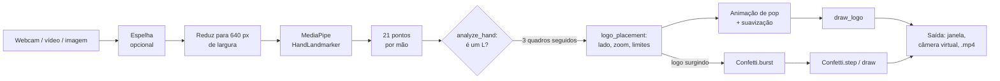

# Como funciona

Este documento explica o que o programa faz a cada quadro de vídeo, por que cada decisão foi tomada e quais números foram medidos. Tudo está em [faz_o_l.py](../faz_o_l.py).

## Visão geral



O laço principal está em `run_webcam`. O modo `--image` (`run_image`) usa as mesmas funções em uma única foto, o que é útil para testar sem câmera.

## 1. Captura

`open_source` abre a webcam com o OpenCV (no Windows usa o backend DirectShow) pedindo **MJPG, 640x360, 30 fps**.

Isso não é um capricho: muitas webcams entregam quadros brutos (YUY2) por USB e ficam limitadas pela banda. Medido numa Logitech C922:

| Resolução | Quadros por segundo |
|---|---|
| 1920x1080 | 5 |
| 1280x720 | 10 |
| 960x540 | 15 |
| 848x480 | 24 |
| 640x360 | 30 |

Com `--video` o OpenCV lê um arquivo no lugar da câmera, o que permite testes repetíveis.

## 2. Detecção das mãos

Usa o **HandLandmarker** da Tasks API do MediaPipe (`mediapipe.tasks.python.vision`), com até 2 mãos, confiança mínima de 0,5 para detecção e para rastreamento. O modelo `hand_landmarker.task` é baixado na primeira execução para `models/`.

- Na webcam usa `RunningMode.VIDEO` (com timestamps crescentes), que acompanha a mão entre quadros e é mais estável e rápida. No modo imagem usa `RunningMode.IMAGE`.
- A detecção roda numa **cópia reduzida a 640 px de largura** (`DETECT_WIDTH`). Em 1280x720 a detecção levava 39 ms por quadro; em 640 px leva 25 ms. Como os landmarks são normalizados (0 a 1), eles são convertidos de volta para pixels do quadro original.
- O código não usa a API antiga `mp.solutions`, que não existe mais no MediaPipe 1.x.

## 3. A regra do "L" (`analyze_hand`)

Recebe os 21 pontos em pixels e calcula quatro métricas, todas divididas pelo **tamanho da palma** (distância entre o pulso e a base do dedo médio), o que torna a regra independente do tamanho da mão na imagem:

| Métrica | Definição | Condição | Constante |
|---|---|---|---|
| `index_reach` | distância pulso → ponta do indicador | ≥ 1,6 (indicador esticado) | `INDEX_MIN_REACH` |
| `others_reach` | maior distância pulso → ponta do médio, anelar e mindinho | ≤ 1,5 (dobrados) | `OTHERS_MAX_REACH` |
| `thumb_open` | distância ponta do polegar → base do indicador | ≥ 0,7 (polegar afastado) | `THUMB_MIN_OPEN` |
| `angle` | ângulo entre o indicador (base → ponta) e o polegar (base → ponta) | entre 40° e 135° | `ANGLE_RANGE` |

A mão faz o "L" quando as quatro condições valem ao mesmo tempo. Como só usa distâncias relativas e um ângulo, a regra funciona com a mão girada, em qualquer tamanho e com a mão esquerda ou direita (isso é coberto por testes).

**Como os limites foram calibrados.** Com fotos reais de pessoas fazendo o "L" (8 de 10 mãos de uma colagem foram reconhecidas; as duas rejeitadas eram casos ambíguos) e com um vídeo de teste de 559 quadros com 59 detecções de mão, onde nenhum quadro disparou o "L" por engano. Os limites foram afrouxados só até cobrir os casos claros, para não ajustar demais em poucas amostras. Se na sua câmera o gesto falhar ou disparar à toa, use `--debug` (ou a tecla `d`) para ver as métricas e ajuste as constantes.

**Limitações conhecidas.**
- Mãos muito pequenas ou cortadas pela borda da imagem não são detectadas pelo MediaPipe.
- Com a mão muito inclinada em relação à câmera (perspectiva forte), as distâncias encolhem e o gesto pode falhar.
- Um polegar relaxado e semiaberto, junto de um indicador esticado, pode ficar perto do limite.

## 4. Estabilização

- **Debounce:** a logo só surge depois de `SHOW_AFTER_FRAMES` (3) quadros seguidos com o "L", e só some depois de `HIDE_AFTER_FRAMES` (6) quadros seguidos sem ele. Isso evita que a logo pisque quando a detecção falha por um instante.
- **Suavização do movimento:** a posição e a largura da logo seguem a mão com média móvel exponencial (`SMOOTHING` = 0,5 para x e y, 0,3 para a largura, que é a mais lenta para o zoom não oscilar). Enquanto a logo está escondida, a posição "salta" direto para a mão, sem deslizar.

## 5. Posição e zoom (`logo_placement`)

### Zoom

A largura da logo vem da **palma**, não da caixa que envolve a mão. A caixa varia entre 1,7 e 2,5 vezes a palma conforme a pose, e por isso não mede bem a distância. A palma (média das distâncias pulso → base do indicador, pulso → base do mindinho e entre as duas bases) é rígida.

```
largura = ZOOM_REF_LOGO × (palma / largura_do_quadro / ZOOM_REF_PALM) ^ zoom × logo_scale
```

- Calibração (`ZOOM_REF_PALM`, `ZOOM_REF_LOGO`): numa foto de referência, a palma ocupava 8,2% da largura do quadro e a logo, 27%.
- `zoom` é a opção `--zoom`: 1 = proporcional; 1,5 exagera; 0,5 suaviza.
- O resultado é limitado a 10% a 65% da largura do quadro (`LOGO_WIDTH_LIMITS`).

Resultado medido simulando a mão em várias distâncias (zoom = 1): palma a 5,4% do quadro, logo com 18%; 7,9% → 26%; 13,3% → 44%; 18,5% → 61%.

### Lado e posição

- **Lado:** a logo vai para o lado para onde o polegar aponta (ponta do polegar à direita ou à esquerda da base do indicador). Se não couber desse lado no quadro, vai para o outro.
- **Horizontal:** a borda da logo avança `LOGO_OVERLAP` (0,2) do tamanho da mão sobre a borda da mão.
- **Vertical:** o centro da logo fica a `LOGO_HEIGHT_AT` (0,4) da altura da mão, contado do topo. A base da logo nunca passa de `LOGO_BOTTOM_MAX` (0,82) da altura da mão, que é o nível do polegar. Assim, quando a logo é grande, ela cresce para cima e não cobre o polegar.
- No fim, o centro é limitado para a logo ficar inteira dentro do quadro.

Essas proporções foram copiadas de uma imagem de referência desenhada à mão.

## 6. Animação de "pop"

Uma variável `visible` (0 a 1) se aproxima do alvo (1 ao aparecer, 0 ao sumir) por suavização exponencial, com taxa de 14 por segundo e independente da taxa de quadros (usa o `dt` real). A escala é `visible × (1 + 0,18 × sin(π × visible))`, o que dá um leve "estouro" no tamanho. A opacidade é `min(1, 1,5 × visible)`.

## 7. Desenho da logo (`load_logo`, `draw_logo`)

- Na leitura, as bordas transparentes são cortadas (o posicionamento usa a área visível) e a cor é **pré-multiplicada pelo alfa**, o que evita halos escuros nas bordas ao redimensionar.
- Cada quadro redimensiona a logo (`INTER_AREA` ao reduzir) e mistura só a região coberta, com operações em `uint8` do OpenCV. Uma versão anterior misturava em ponto flutuante com NumPy e só essa etapa levava 9 ms por quadro; hoje o desenho completo da logo leva cerca de 1,3 ms.
- A logo é recortada nas bordas do quadro, então é seguro desenhá-la parcialmente fora da imagem.

## 8. Confete (`Confetti`)

Um sistema de partículas simples, vetorizado com NumPy.

- **Disparo:** uma vez, no quadro em que a logo começa a surgir (`target` passa de 0 para 1). Detecções que falham por poucos quadros não disparam de novo.
- **Cores:** as cinco medidas na logo (veja [IDENTIDADE_VISUAL.md](IDENTIDADE_VISUAL.md)), com pesos 0,28 amarelo, 0,28 verde, 0,22 azul, 0,12 branco e 0,10 vermelho. O vermelho fica em menor proporção, na linha da diretriz de comunicação de "mais verde, amarelo, azul e branco".
- **Formas:** retângulos que giram em 3D (a espessura varia com o cosseno de uma fase), a estrela de cinco pontas da logo e o losango da bandeira. Cada pedaço tem um contorno 45% mais escuro que a cor, para aparecer em fundos claros (principalmente o branco).
- **Física:** os pedaços nascem espalhados pela área da logo e saem do centro para fora, com aleatoriedade e um empurrão para cima. A cada passo: gravidade (`CONFETTI_GRAVITY`), arrasto (`CONFETTI_DRAG`), rotação e giro. O `dt` é limitado a 0,1 s para um travamento não teletransportar as partículas.
- **Fim de vida:** nos últimos 0,35 s o pedaço encolhe até sumir (em vez de ficar transparente, o que evita misturar cada um com o fundo).
- **Escala:** tamanho e velocidade acompanham a largura do quadro (referência de 640 px) e o tamanho da logo: com a mão mais perto, o confete é até 50% maior.
- **Custo:** cerca de 2,4 ms por quadro com 120 pedaços.

## 9. Saídas

- **Janela de preview** (`cv2.imshow`). Teclas `q`/`ESC` e `d`.
- **Câmera virtual** (`--virtual-cam`): `pyvirtualcam` com formato BGR, a 30 fps, usando o backend do OBS. O quadro enviado é o mesmo da janela.
- **Arquivo** (`--save`): `.mp4` (codec `mp4v`) a 30 fps.

## 10. Desempenho

Medido no Windows 11, com uma C922 em 640x360:

| Etapa | Tempo |
|---|---|
| Leitura da câmera | limitada pelo hardware (30 fps) |
| Detecção das mãos (640 px) | ~25 ms |
| Desenho da logo | ~1,3 ms |
| Confete (120 pedaços) | ~2,4 ms |
| **Total** | **~29 fps** |

## 11. Alternativas descartadas

- **Logo "mesclada" com a mão.** A ideia era alinhar o primeiro "L" de "LULA" ao "L" da mão, com a mão na frente da logo (por uma máscara feita dos landmarks). Funcionou tecnicamente, mas o "L" da logo ocupa só 13% da largura dela, então, para casar com a mão, a logo teria mais de 1.000 px e não caberia no quadro de 640 px. Reduzindo a logo para caber, o alinhamento se perdia e a mão tapava as letras. Foi trocada por posicionar a logo ao lado da mão.
- **Tamanho pela caixa da mão** no lugar da palma: variava demais com a pose.
- **Mistura em ponto flutuante:** 9 ms por quadro; trocada por `uint8`.
- **Resolução 1280x720:** 10 fps na câmera usada.

## 12. Testes

`pytest` roda 67 testes em poucos segundos, sem câmera nem o arquivo do modelo:

- `tests/test_gesture.py`: a regra do "L" com mãos sintéticas (rotação, escala, espelhamento, gestos que **não** são "L").
- `tests/test_placement.py`: lado da logo, limites do quadro, zoom, calibração e a base acima do polegar.
- `tests/test_render.py`: carregamento da logo, mistura, recorte nas bordas e o confete.
- `tests/test_cli.py`: a proteção que impede `--save` e `--out` de sobrescreverem o arquivo de entrada (`--video` e `--image`), inclusive com caminhos escritos de outro jeito e hard links. O gravador de vídeo só é aberto por `open_writer`, que faz essa checagem.

As mãos sintéticas estão em `tests/hands.py` (21 pontos montados por código, sem imagens de pessoas).
